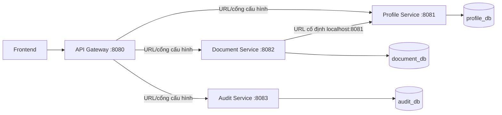
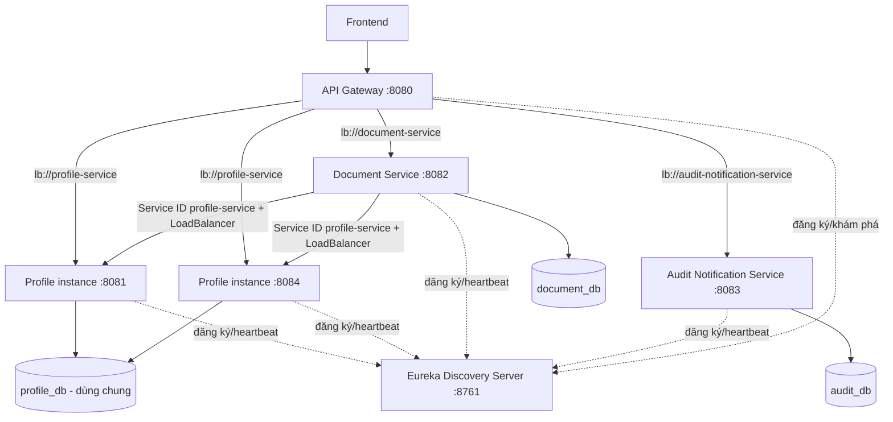

# Thiết kế Microservices – Student Profile System (Nhóm 9)

## Ranh giới dịch vụ và quyền sở hữu dữ liệu

| Service ID | Trách nhiệm | API chính | Dữ liệu sở hữu | Consumer / Provider |
|---|---|---|---|---|
| `PROFILE-SERVICE` | Đăng nhập, JWT, quản lý hồ sơ sinh viên | `/api/v1/auth/**`, `/api/v1/profiles/**`, `/api/v1/instance-info` | `profile_db` | Consumer: API Gateway, Document Service. Provider: Profile API |
| `DOCUMENT-SERVICE` | Quản lý metadata và file tài liệu sinh viên; xác minh chủ hồ sơ trước khi lưu | `/api/v1/documents/**`, `/api/v1/documents/discovery/profile-instance-info` | `document_db`, thư mục `uploads/` | Consumer: API Gateway; Provider: Profile Service qua Eureka |
| `AUDIT-NOTIFICATION-SERVICE` | Nhận sự kiện RabbitMQ và cung cấp nhật ký kiểm toán | `/api/v1/audits/**`, `/health` | `audit_db` | Consumer: RabbitMQ; Provider: API Gateway qua Eureka |
| `API-GATEWAY` | Cổng truy cập HTTP, định tuyến theo Service ID | Cùng các route `/api/v1/**` được khai báo | Không có DB nghiệp vụ | Consumer: Frontend; Provider: Profile, Document, Audit |
| `DISCOVERY-SERVER` | Đăng ký, lưu lease và cung cấp danh sách instance Eureka | Dashboard `:8761`, REST `/eureka/**` | Registry metadata, không phải DB nghiệp vụ | Được các service đăng ký và consumer truy vấn |

`PROFILE-SERVICE` và `DOCUMENT-SERVICE` là các tiến trình Spring Boot. `AUDIT-NOTIFICATION-SERVICE` là Node.js/Express, cũng đăng ký Eureka qua REST API. Mỗi service chỉ truy cập database do chính nó sở hữu; Document Service không truy vấn trực tiếp `profile_db`.

## Kiến trúc trước khi áp dụng Discovery

## Kiến trúc sau khi áp dụng TH7

Hai Profile instance cùng Service ID, cùng API contract và cùng PostgreSQL database. Instance thứ hai không tạo database độc lập, tránh hai bộ hồ sơ lệch dữ liệu.
