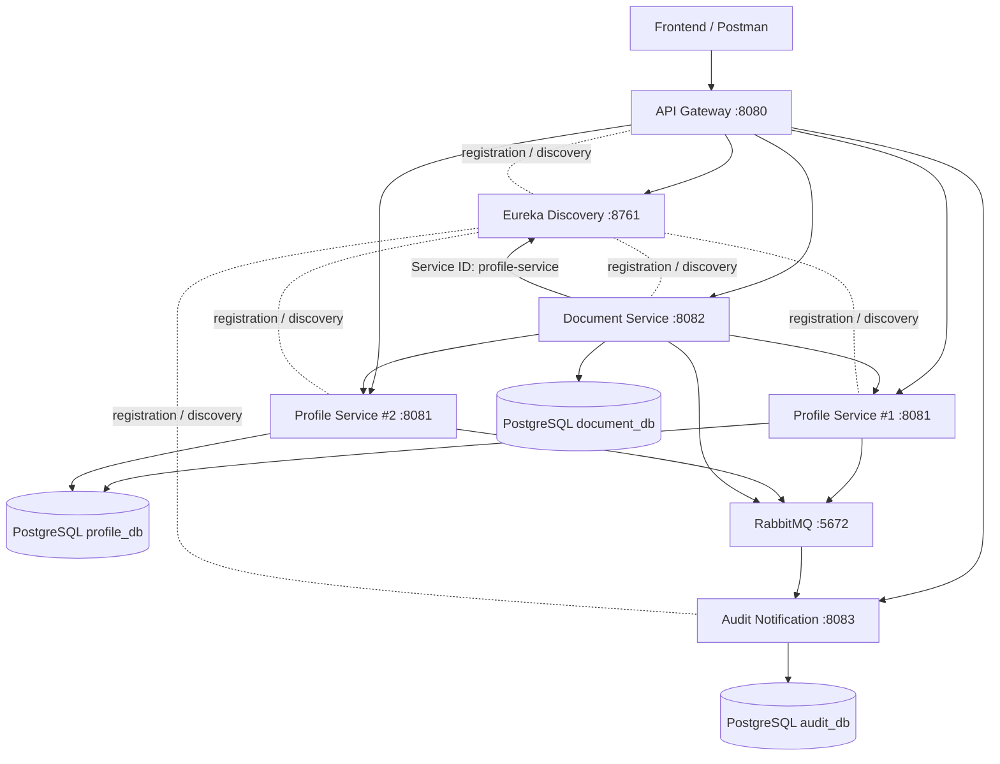

# Thiết kế triển khai TH8

## 1. Phạm vi

Triển khai chính hệ thống SOA-Student-Services hiện có bằng Docker Compose; không thay đổi nghiệp vụ. Các thành phần gồm API Gateway, Eureka Discovery Server, Profile Service (2 instance), Document Service, Audit Notification Service, PostgreSQL và RabbitMQ.

## 2. Sơ đồ triển khai

> Các container trên cùng Docker bridge network `student-network`; mũi tên đăng ký/discovery biểu diễn quan hệ Eureka, không phải luồng HTTP nghiệp vụ.

## 3. Bảng thành phần

| Thành phần | Docker Compose service | Cổng container | Database / phụ thuộc | Vai trò |
|---|---|---:|---|---|
| API Gateway | `api-gateway` | 8080 | Eureka | Cổng truy cập API cho Frontend, định tuyến `lb://` |
| Eureka | `discovery-server` | 8761 | Không | Service Registry/Discovery |
| Profile instance 1 | `profile-service` | 8081 | `profile_db`, RabbitMQ, Eureka | Hồ sơ và xác thực |
| Profile instance 2 | `profile-service-2` | 8081 | Dùng chung `profile_db`, RabbitMQ, Eureka | Mở rộng ngang cùng Service ID |
| Document | `document-service` | 8082 | `document_db`, RabbitMQ, Eureka, Profile API | Quản lý tài liệu và upload |
| Audit | `audit-notification-service` | 8083 | `audit_db`, RabbitMQ, Eureka | Nhận sự kiện và lưu audit log |
| PostgreSQL | `postgres` | 5432 | Volume `postgres_data` | Lưu ba database nghiệp vụ |
| RabbitMQ | `rabbitmq` | 5672/15672 | Volume `rabbitmq_data` | Message broker |

## 4. Mạng và DNS

Tất cả container thuộc bridge network `student-network`. Container gọi nhau bằng tên Compose: `discovery-server`, `postgres`, `rabbitmq`, `profile-service`, `document-service`, `audit-notification-service`. Không dùng `localhost` làm địa chỉ container khác. `localhost` chỉ dùng trong healthcheck nội bộ của chính container.

Gateway định tuyến qua Eureka. Document gọi Profile bằng service URL `http://profile-service/...`; Eureka/LoadBalancer phân giải Service ID. Hai Profile instance cùng đăng ký dưới `profile-service` nhưng có `instance-id` khác nhau.

## 5. Dữ liệu bền vững

- `postgres_data`: dữ liệu PostgreSQL của `profile_db`, `document_db`, `audit_db`.
- `rabbitmq_data`: metadata/message bền vững của RabbitMQ (message durability vẫn phụ thuộc khai báo queue/message ở ứng dụng).
- `document_uploads`: file PDF/PNG/JPG tải lên, mount tại `/app/uploads`.

Không dùng `docker compose down -v` khi kiểm tra restart/bảo toàn dữ liệu. Trước khi nâng cấp môi trường có dữ liệu, sao lưu PostgreSQL.

## 6. Health check

Spring Boot services expose `/actuator/health` và `/actuator/info`; thông tin chi tiết health không được public. Compose healthcheck gọi endpoint health. Audit Node.js giữ endpoint `/health` và kiểm tra kết nối PostgreSQL. PostgreSQL và RabbitMQ sử dụng lệnh kiểm tra chuyên dụng.

## 7. Bảo mật triển khai

Secrets được truyền qua `.env` (không commit). Dockerfile chỉ build ứng dụng, không COPY `.env` hoặc secret vào image. Java runtime chạy bằng UID không phải root. PostgreSQL/RabbitMQ chỉ publish vào loopback của máy host; Gateway là cổng API public duy nhất mặc định.
